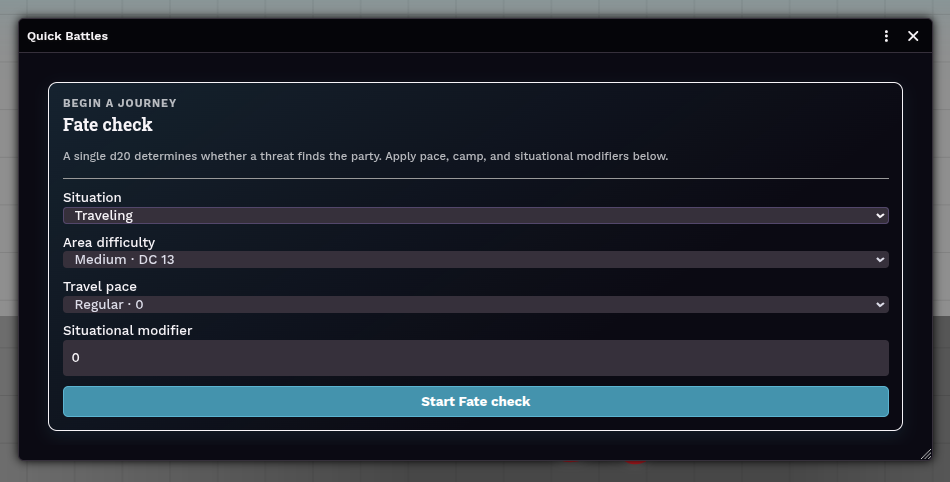
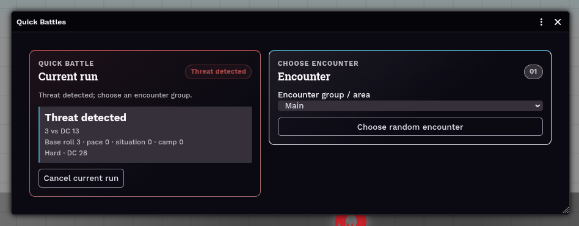
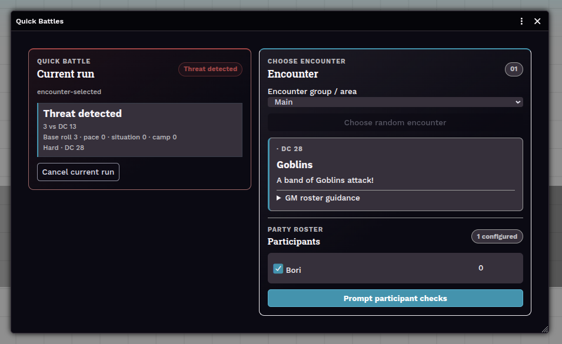

# Skyy's Quick Battles

This Foundry VTT module is for those who want a way to allow draining resources of heroes while traveling, without having them play out entire tactical battles. It allows you to roll chance for battle, a randomized encounter with a configured DC, and the ability for players to each choose which resources they want to spend (if any) in the battle, and make one D20 roll with the bonuses for a fated roll. Failure costs the character hit points.

## Installation
Paste the manifest url in your Foundry module install window.
[https://github.com/carelvhza/skyys-quick-battles/releases/latest/download/module.json](https://github.com/carelvhza/skyys-quick-battles/releases/latest/download/module.json)

## Configuration
You can configure the settings by finding it in the Game Settings menu under Skyy's Quick Battles.

Before you can use Quick Battles, you need to add participating players and encounters.
There are various configuration options for the various numbers and modifiers that are used in the rolls.
See **Usage** for more information.

Add players and make sure to select the actor player characters to use in the battles.
Add at least one encounter, by specifying the name, the group it is in (for example, groups can be regions the party is traveling in), and if you want, configure a description, override the values, and add enemies. These enemies are just there if you choose to add a 'Combat' encounter difficulty band that would trigger actual combat. It won't automatically create the combat, but it will list the enemies for the encounter if it is a combat encounter.

## Usage
Access the Quick Battles screen by clicking its button under User Tokens' sub menu, or by pressing Shift+Alt+B. You can also activate it via a chat command /quickbattles.

Choose the situation, area difficulty and travel pace. The situation and area difficulty options can be customized in settings.
Then, you click Start Fate check, which triggers a roll for you on Foundry (it will be a 1dX, where x is the number of participating players). That will randomize and prompt a random player to roll a D20 'fate' roll and add the bonuses. If it beats the area difficulty dc, then no quick battle starts. On a fail, it will trigger more rolls for you, which are used to determine the difficulty of the battle, and if it is in first or second shift (if the situation is camping). The shifts refer to guard shifts during a long rest.

You will then get a screen that will allow you to roll a random encounter for the selected group / area.

After that you will be able to prompt participants to do their quick battle checks, based on the rolled encounter.

The prompt to the player wills how them a list of passive bonuses, and active features and spell slots. The player can spend these to increase their roll, and will then roll a D20. On a success, they take no damage, on a fail, they take damage based on the difference between the DC and their roll.

> There are configurable options for limiting number of active feats of spell slots that can be spent, the scores for spell levels, whether the damage should be capped less than 100% (using a fraction 1 == can take 100% damage, and 0.5 would be max 50% per battle).
> You can also configure the feats, by overriding them by name, or by adding custom feats or missing feats in, assigning the impact on the roll they give.

## AI Usage

I have used significant AI use to help me code this. I wouldn't describe this as 'vibe coded' though, as I made many changes myself. It is a passion module that I made for myself, so it has no large significance, but if you do not approve of the use of AI, then you are informed of its use in this project.

## License

This project is licensed under the [MIT License](https://opensource.org/license/mit).